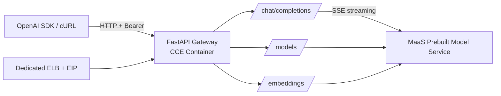

# application-intelligence-model-access-gateway

[](LICENSE)
[](LICENSE)
[](https://www.huaweicloud.com)
An OpenAI-compatible model access gateway that provides unified access to Huawei Cloud MaaS prebuilt model services, offering chat (including SSE streaming), text embedding, and model listing APIs.

## 1. Overview

### Introduction

Provides a modification-free integration path for existing OpenAI API applications (LangChain, AutoGen, in-house Agents, etc.): call this gateway with the OpenAI SDK / cURL; the gateway handles unified authentication and forwards requests to Huawei Cloud MaaS model services, returning OpenAI-format responses.

Ideal for: teams that need unified model allowlist management, unified authentication, and flexible switching among multiple models.

---

## 2. Table of Contents

- [1. Overview](#1-overview)
- [2. Table of Contents](#2-table-of-contents)
- [3. Architecture Diagram](#3-architecture-diagram)
- [4. Highlights](#4-highlights)
- [5. Cloud Services Used](#5-cloud-services-used)
- [6. Prerequisites](#6-prerequisites)
- [7. Quick Start](#7-quick-start)
- [8. Step-by-Step Deployment](#8-step-by-step-deployment)
- [9. Usage / Verification](#9-usage--verification)
- [10. Cleanup](#10-cleanup)
- [11. Detailed Explanation](#11-detailed-explanation)
- [12. Dependencies](#12-dependencies)
- [13. FAQ / Troubleshooting](#13-faq--troubleshooting)
- [14. Contributing](#14-contributing)
- [15. License](#15-license)
- [16. Contact / Maintainers](#16-contact--maintainers)

### Repository Structure

```
├── docs/                 Architecture documentation + deployment guide
├── infra/                Terraform + huaweicloud Provider (VPC/CCE/SWR)
└── src/
    ├── api/              FastAPI gateway code (including the MaaS model adapter layer)
    ├── k8s/              Deployment / Service / Secret manifests
    ├── Dockerfile
    └── requirements.txt
```

---

## 3. Architecture Diagram



See [docs/architecture.md](docs/architecture.md) for details.

---

## 4. Highlights

- **OpenAI Compatible**: Requests and responses are both in OpenAI format, requiring zero client-side changes.
- **SSE Streaming**: Native streaming output with `stream=true`, supporting `include_usage`.
- **Unified Authentication**: Gateway-level API Key (Bearer), decoupled from the model service API Key.
- **Model Allowlist**: The `MODEL_LIST` environment variable lets you add or remove models in one place, and the `/models` API returns them dynamically.
- **Tool Calling**: Native passthrough of the OpenAI tools / tool_calls format.
- **Containerized Deployment**: Fully managed with CCE + SWR + ELB; stateless and horizontally scalable.

---

## 5. Cloud Services Used

- CCE (Cloud Container Engine): gateway container orchestration
- SWR (SoftWare Repository for Container): image hosting
- ELB (Elastic Load Balance): public network entry point
- EIP (Elastic IP): public IP address
- MaaS (ModelArts Studio prebuilt model service): chat and embedding models

> Clean up resources promptly when they are no longer in use to avoid leftovers (see [Cleanup](#10-cleanup)).

---

## 6. Prerequisites

- A Huawei Cloud account with target region `cn-north-4`, with CCE / SWR / ELB / EIP enabled.
- Locally: `terraform` ≥1.5, `docker`, `kubectl`.
- **MaaS prebuilt service enabled** and an API Key created (Console: ModelArts → Prebuilt Services → Enable; API Key Management → Create).
  - The MaaS prebuilt service is currently available in only some regions (Southwest-Guizhou-1 / North-China-Ulanqab-1 / China-Hong Kong); the gateway can be deployed in `cn-north-4`, and model calls go over the public network.
- Credentials are provided through environment variables / K8s Secrets; do not write real keys into code or configuration files.

---

## 7. Quick Start

For the full deployment, see [docs/deployment-guide.md](docs/deployment-guide.md). Core three steps:

```bash
# 1. Create the infrastructure (VPC/CCE/SWR)
cd infra && terraform init && terraform apply

# 2. Build and push the image
docker build -t swr.cn-north-4.myhuaweicloud.com/<org>/model-access-gateway:latest src/
docker push swr.cn-north-4.myhuaweicloud.com/<org>/model-access-gateway:latest

# 3. Deploy the gateway (fill in src/k8s/secret.yaml first)
kubectl apply -f src/k8s/
```

---

## 8. Step-by-Step Deployment

1. **Create the infrastructure**: `cd infra`, run `cp terraform.tfvars.example terraform.tfvars` and fill it in, then run `terraform apply`.
2. **Build the image**: `docker build` + `docker push` (see the `swr_image` output from infra for the image address).
3. **Configure the Secret**: edit `src/k8s/secret.yaml`, fill in the gateway API Key and the MaaS API Key, then run `kubectl apply -f secret.yaml`.
4. **Deploy the gateway**: `kubectl apply -f deployment.yaml -f service.yaml`.
5. **Get the address**: `kubectl get svc gateway`; `EXTERNAL-IP` is the public entry point.

---

## 9. Usage / Verification

### Usage and Verification

After deployment, verify using the gateway API Key and the public address:

```bash
export GATEWAY_BASE="http://<EXTERNAL-IP>/api/v1"
export GATEWAY_API_KEY="<your-gateway-api-key>"

# 1. Health check
curl $GATEWAY_BASE/../health

# 2. Model list
curl $GATEWAY_BASE/models \
  -H "Authorization: Bearer $GATEWAY_API_KEY"

# 3. Chat (non-streaming)
curl $GATEWAY_BASE/chat/completions \
  -H "Content-Type: application/json" \
  -H "Authorization: Bearer $GATEWAY_API_KEY" \
  -d '{
    "model": "DeepSeek-V4-Flash",
    "messages": [{"role": "user", "content": "你好，用一句话介绍你自己"}]
  }'

# 4. Chat (SSE streaming)
curl -N $GATEWAY_BASE/chat/completions \
  -H "Content-Type: application/json" \
  -H "Authorization: Bearer $GATEWAY_API_KEY" \
  -d '{
    "model": "DeepSeek-V4-Flash",
    "stream": true,
    "messages": [{"role": "user", "content": "从 1 数到 5"}]
  }'

# 5. Text embedding
curl $GATEWAY_BASE/embeddings \
  -H "Content-Type: application/json" \
  -H "Authorization: Bearer $GATEWAY_API_KEY" \
  -d '{
    "model": "BGE-M3",
    "input": ["华为云大模型服务"]
  }'
```

**Python SDK Example**:

```python
from openai import OpenAI

client = OpenAI(
    api_key="<your-gateway-api-key>",
    base_url="http://<EXTERNAL-IP>/api/v1",
)

completion = client.chat.completions.create(
    model="DeepSeek-V4-Flash",
    messages=[{"role": "user", "content": "你好！"}],
)
print(completion.choices[0].message.content)
```

> After deployment, follow these steps to verify that the business functionality works before considering the delivery complete.

---

## 10. Cleanup

```bash
# Delete the K8s resources (including the automatically created ELB / EIP)
kubectl delete -f src/k8s/

# Destroy the infrastructure (CCE cluster, nodes, SWR, VPC)
cd infra && terraform destroy -auto-approve
```

---

## 11. Detailed Explanation

### API Overview

| Method | Path | Description |
|---|---|---|
| GET | `/health` | Health check |
| GET | `/api/v1/models` | Model list (configured by `MODEL_LIST`) |
| GET | `/api/v1/models/{model_id}` | Validate a single model |
| POST | `/api/v1/chat/completions` | Chat completions (SSE streaming when `stream=true`) |
| POST | `/api/v1/embeddings` | Text embedding |

### Supported Capabilities

- Chat / streaming chat (SSE + include_usage)
- Tool calling (OpenAI tools / tool_calls)
- Text embedding (float / base64 encoding)
- Model allowlist and validation
- CORS configuration (`ALLOWED_ORIGINS`)

### Configuration Items

See the "Configuration Items" table in [docs/architecture.md](docs/architecture.md) (`API_KEY`, `MAAS_API_KEY`, `MAAS_CHAT_BASE_URL`, `MAAS_EMBED_BASE_URL`, `DEFAULT_MODEL`, `MODEL_LIST`, `VISION_ENABLED`, etc.).

---

## 12. Dependencies

- [FastAPI](https://fastapi.tiangolo.com/) / [uvicorn](https://www.uvicorn.org/): API framework
- [openai-python](https://github.com/openai/openai-python): client for the MaaS OpenAI-compatible endpoint

---

## 13. FAQ / Troubleshooting

### FAQ

**Q1: `401 Invalid API Key`**
The gateway API Key does not match `API_KEY` in `secret.yaml`. Check the request header and the Secret configuration.

**Q2: Model calls return 4xx/5xx**
Confirm that `MAAS_API_KEY` is valid, the MaaS service is enabled, and the model name matches `MODEL_LIST`. The MaaS prebuilt service has region restrictions, and model calls go over the public network (the container must have outbound network access).

**Q3: Image input has no effect**
The prebuilt chat model is text-only, so image blocks are ignored (`VISION_ENABLED=false`). Use text/metadata-driven input instead, or connect a multimodal-capable model and then set `VISION_ENABLED=true`.

**Q4: Streaming output does not take effect**
Confirm that the request includes `"stream": true` and that `curl` uses `-N` (or that the SDK sets the streaming parameter).

---

## 14. Contributing

Issues are welcome for bug reports or improvement suggestions. Please submit feedback through the project Issue channel.

---

## 15. License

This practice is licensed under **MIT No Attribution**; see [LICENSE](LICENSE).

---

## 16. Contact / Maintainers
| Item | Content |
|---|---|
| **Creator** | [dgc-git](https://github.com/dgc-git) |
| **Maintainer** | [dgc-git](https://github.com/dgc-git) |
| **Contact** | GitHub Issues / PR (see [Section 14](#14-contributing)) |
