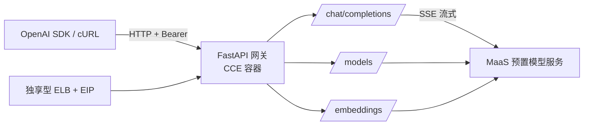

# application-intelligence-model-access-gateway · AI Model Access Gateway

[](LICENSE)
[](LICENSE)
[](https://www.huaweicloud.com)
OpenAI 兼容的模型访问网关：统一接入华为云 MaaS 预置模型服务，提供对话（含 SSE 流式）、文本向量化与模型清单 API。

## 1. 简介 / Overview

### 简介


为已有 OpenAI API 应用（LangChain、AutoGen、自研 Agent 等）提供一条免改造的接入路径：以 OpenAI SDK / cURL 调用本网关，网关统一鉴权并转发到华为云 MaaS 模型服务，返回 OpenAI 格式响应。

适合：需要统一管理模型白名单、统一鉴权、在多个模型之间灵活切换的团队。

---

## 2. 目录

- [1. 简介 / Overview](#1-简介--overview)
- [2. 目录](#2-目录)
- [3. 架构图](#3-架构图)
- [4. 方案亮点](#4-方案亮点)
- [5. 涉及云服务](#5-涉及云服务)
- [6. 前置条件](#6-前置条件)
- [7. 快速开始](#7-快速开始)
- [8. 分步部署](#8-分步部署)
- [9. 使用方法 / 验证](#9-使用方法--验证)
- [10. 清理资源](#10-清理资源)
- [11. 详细说明](#11-详细说明)
- [12. 依赖](#12-依赖)
- [13. FAQ / 故障排除](#13-faq--故障排除)
- [14. 贡献指南](#14-贡献指南)
- [15. 许可证](#15-许可证)
- [16. 联系方式 / 维护者](#16-联系方式--维护者)

### 仓库结构


```
├── docs/                 架构说明 + 部署指导书
├── infra/                Terraform + huaweicloud Provider（VPC/CCE/SWR）
└── src/
    ├── api/              FastAPI 网关代码（含 MaaS 模型适配层）
    ├── k8s/              Deployment / Service / Secret 清单
    ├── Dockerfile
    └── requirements.txt
```

---

## 3. 架构图



详见 [docs/architecture.md](docs/architecture.md)。

---

## 4. 方案亮点

- **OpenAI 兼容**：请求/响应均为 OpenAI 格式，客户端零改造。
- **SSE 流式**：`stream=true` 原生流式输出，支持 `include_usage`。
- **统一鉴权**：网关级 API Key（Bearer），与模型服务 API Key 解耦。
- **模型白名单**：`MODEL_LIST` 环境变量一键增删模型，`/models` API 动态返回。
- **工具调用**：OpenAI tools / tool_calls 格式原生透传。
- **容器化部署**：CCE + SWR + ELB 全托管，无状态可水平扩展。

---

## 5. 涉及云服务

- CCE（云容器引擎）：网关容器编排
- SWR（容器镜像服务）：镜像托管
- ELB（弹性负载均衡）：公网入口
- EIP（弹性公网 IP）：公网地址
- MaaS（ModelArts Studio 预置模型服务）：对话与向量化模型

> 资源不再使用时请及时清理，避免残留（见 [清理资源](#清理资源)）。

---

## 6. 前置条件

- 华为云账号，目标区域 `cn-north-4`，已开通 CCE / SWR / ELB / EIP。
- 本地：`terraform` ≥1.5、`docker`、`kubectl`。
- **MaaS 预置服务已开通**并已创建 API Key（控制台 ModelArts → 预置服务 → 开通；API Key 管理 → 创建）。
  - MaaS 预置服务当前仅部分区域可用（西南-贵阳一 / 华北-乌兰察布一 / 中国香港）；网关可部署在 `cn-north-4`，模型调用走公网。
- 凭据经环境变量 / K8s Secret 注入，请勿在代码或配置文件中写入真实密钥。

---

## 7. 快速开始

完整部署见 [docs/deployment-guide.md](docs/deployment-guide.md)，核心三步：

```bash
# 1. 创建基础设施（VPC/CCE/SWR）
cd infra && terraform init && terraform apply

# 2. 构建并推送镜像
docker build -t swr.cn-north-4.myhuaweicloud.com/<org>/model-access-gateway:latest src/
docker push swr.cn-north-4.myhuaweicloud.com/<org>/model-access-gateway:latest

# 3. 部署网关（先填好 src/k8s/secret.yaml）
kubectl apply -f src/k8s/
```

---

## 8. 分步部署

1. **创建基础设施**：`cd infra`，`cp terraform.tfvars.example terraform.tfvars` 并填写，执行 `terraform apply`。
2. **构建镜像**：`docker build` + `docker push`（镜像地址见 infra 输出 `swr_image`）。
3. **配置 Secret**：编辑 `src/k8s/secret.yaml`，填入网关 API Key 与 MaaS API Key，`kubectl apply -f secret.yaml`。
4. **部署网关**：`kubectl apply -f deployment.yaml -f service.yaml`。
5. **获取地址**：`kubectl get svc gateway`，`EXTERNAL-IP` 即公网入口。

---

## 9. 使用方法 / 验证

### 使用方法与验证


部署完成后，用网关 API Key 与公网地址验证：

```bash
export GATEWAY_BASE="http://<EXTERNAL-IP>/api/v1"
export GATEWAY_API_KEY="<your-gateway-api-key>"

# 1. 健康检查
curl $GATEWAY_BASE/../health

# 2. 模型清单
curl $GATEWAY_BASE/models \
  -H "Authorization: Bearer $GATEWAY_API_KEY"

# 3. 对话（非流式）
curl $GATEWAY_BASE/chat/completions \
  -H "Content-Type: application/json" \
  -H "Authorization: Bearer $GATEWAY_API_KEY" \
  -d '{
    "model": "DeepSeek-V4-Flash",
    "messages": [{"role": "user", "content": "你好，用一句话介绍你自己"}]
  }'

# 4. 对话（SSE 流式）
curl -N $GATEWAY_BASE/chat/completions \
  -H "Content-Type: application/json" \
  -H "Authorization: Bearer $GATEWAY_API_KEY" \
  -d '{
    "model": "DeepSeek-V4-Flash",
    "stream": true,
    "messages": [{"role": "user", "content": "从 1 数到 5"}]
  }'

# 5. 文本向量化
curl $GATEWAY_BASE/embeddings \
  -H "Content-Type: application/json" \
  -H "Authorization: Bearer $GATEWAY_API_KEY" \
  -d '{
    "model": "BGE-M3",
    "input": ["华为云大模型服务"]
  }'
```

**Python SDK 示例**：

```python
from openai import OpenAI

client = OpenAI(
    api_key="<your-gateway-api-key>",
    base_url="http://<EXTERNAL-IP>/api/v1",
)

completion = client.chat.completions.create(
    model="DeepSeek-V4-Flash",
    messages=[{"role": "user", "content": "你好！"}],
)
print(completion.choices[0].message.content)
```

> **请部署完成后按本节步骤自行验证**，确认上述命令输出正常、业务功能可用后，方可视为交付完成。

---

## 10. 清理资源

```bash
# 删除 K8s 资源（含自动创建的 ELB / EIP）
kubectl delete -f src/k8s/

# 销毁基础设施（CCE 集群、节点、SWR、VPC）
cd infra && terraform destroy -auto-approve
```

---

## 11. 详细说明

### API 一览

| 方法 | 路径 | 说明 |
|---|---|---|
| GET | `/health` | 健康检查 |
| GET | `/api/v1/models` | 模型清单（`MODEL_LIST` 配置） |
| GET | `/api/v1/models/{model_id}` | 校验单个模型 |
| POST | `/api/v1/chat/completions` | 对话补全（`stream=true` 时 SSE 流式） |
| POST | `/api/v1/embeddings` | 文本向量化 |

### 支持的能力

- 对话 / 流式对话（SSE + include_usage）
- 工具调用（OpenAI tools / tool_calls）
- 文本向量化（float / base64 编码）
- 模型白名单与校验
- CORS 配置（`ALLOWED_ORIGINS`）

### 配置项

见 [docs/architecture.md](docs/architecture.md)「配置项」表（`API_KEY`、`MAAS_API_KEY`、`MAAS_CHAT_BASE_URL`、`MAAS_EMBED_BASE_URL`、`DEFAULT_MODEL`、`MODEL_LIST`、`VISION_ENABLED` 等）。

---

## 12. 依赖

- [FastAPI](https://fastapi.tiangolo.com/) / [uvicorn](https://www.uvicorn.org/)：API 框架
- [openai-python](https://github.com/openai/openai-python)：MaaS OpenAI 兼容端点客户端

---

## 13. FAQ / 故障排除

### FAQ


**Q1：`401 Invalid API Key`**
网关 API Key 与 `secret.yaml` 中 `API_KEY` 不一致。检查请求头与 Secret 配置。

**Q2：模型调用 4xx/5xx**
确认 `MAAS_API_KEY` 有效、MaaS 服务已开通且模型名与 `MODEL_LIST` 一致。MaaS 预置服务有区域限制，模型调用走公网（容器需可出网）。

**Q3：图片输入无效**
预置对话模型为纯文本模型，图片块被忽略（`VISION_ENABLED=false`）。请改用文本/元数据驱动，或接入支持多模态的模型后置 `VISION_ENABLED=true`。

**Q4：流式输出未生效**
确认请求带 `"stream": true` 且 `curl` 加 `-N`（或 SDK 设置流式参数）。

---

## 14. 贡献指南

欢迎提交 Issue 反馈问题或改进建议。请通过项目 Issue 渠道提交反馈。

---

## 15. 许可证

本实践采用 **MIT No Attribution** 许可证，详见 [LICENSE](LICENSE)。

---

## 16. 联系方式 / 维护者
| 项 | 内容 |
|---|---|
| **创建者** | [dgc-git](https://github.com/dgc-git) |
| **维护者** | [dgc-git](https://github.com/dgc-git) |
| **联系方式** | GitHub Issues / PR（见[第 14 节](#14-贡献指南)） |
